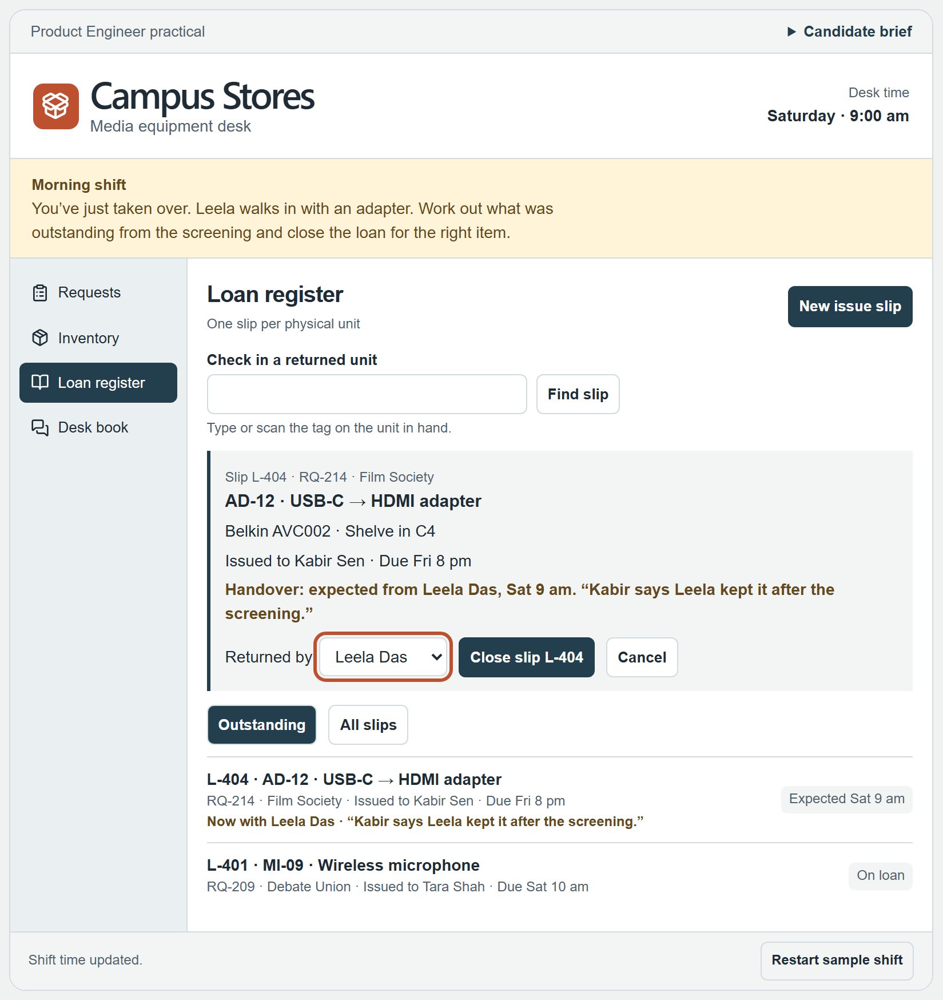

# Campus Stores

> **Reviewers:** my submission is below, under [Candidate submission](#candidate-submission). To try it, run the app (see [Run the app](#run-the-app)), click **Restart sample shift**, and work the Film Society shift. The changes are in `app.js` and `styles.css`, and the screenshots are in `docs/`.

## Candidate submission

**Decision:** keep the one-slip-per-unit register. Change how a loan crosses a shift boundary. Who has an item, and when it's coming back, should be written on the slip itself. And a slip should only close against the tag on the unit that's actually on the counter.

### The shift I worked (original app)

- **Fri 3:45 pm, pickup.** I issued RQ-214 to Kabir Sen on three slips: L-402 PR-04 projector, L-403 SP-02 speaker and L-404 AD-12 adapter. PR-06, which is in the workshop, was never offered. When I tried CA-03 against RQ-214, the register refused it.
- **Fri 7:30 pm, partial return.** I recorded returns on L-402 and L-403. Kabir said Leela had the adapter and would bring it at nine. L-404 had nowhere to put that, so I wrote it in the Desk book.
- **Sat 9:00 am, morning shift.** The register showed `L-404 · AD-12 — RQ-214 · Kabir Sen · Due Fri 8 pm` above Tara's microphone. Each row had a **Record return** button.

### A moment it handles well (keep)

**7:30 pm: the kit came back in pieces, and the register didn't care.** Every physical unit has its own slip, so closing L-402 and L-403 left L-404 open with no workaround. Inventory immediately showed PR-04 and SP-02 on the shelf and AD-12 still on loan. In the morning, exactly one Film Society item was outstanding. With one slip per request I'd have had two bad choices: close the whole kit and lose track of the adapter, or leave it all open and claim the projector was still out. Pickup was guarded the same way. With fifteen minutes before the film, the form only offered units that could actually leave, and it refused one the club hadn't been approved for.

### A moment I'd change

**9:00 am: Leela was at the counter, and nothing on L-404 connected her to it.**


- What I'd learned at 7:30 pm (*Leela has it, back at nine*) lived only in a free-text note on another tab.
- L-404 said `AD-12 · Kabir Sen · Due Fri 8 pm`. It didn't mention Leela, didn't say "adapter", and didn't say it was 13 hours late. To work out that her adapter was L-404, I read the Desk book and then looked AD-12 up in Inventory. AD-12 and AD-15 are two different adapters in the same bin, C4.
- **Record return** is one click. It doesn't check which unit is on the counter or record who brought it back, and it can't be undone. I double-clicked it: the first click closed L-404, the list reflowed, and the second click closed **L-401, Tara's microphone, which was still with Tara**. Inventory then showed MI-09 on the shelf.

### The change: the handover lives on the slip

1. **Check in by tag.** One field replaces the per-row return buttons: *Check in a returned unit — type or scan the tag on the unit in hand.* Entering `AD-12` (or `ad12`, or a scan) opens that slip. The card shows the model, the shelf it goes back to, who it was issued to and any handover. *Returned by* is preselected to the person the slip says is bringing it back. Closing the slip records who returned it and when. A tag with no open slip is stopped, and the message names the slip you probably meant. With no row buttons, a double-click can't close someone else's loan.
2. **"Who has the rest?"** When a request has some units back and some still out, the register asks who has the rest. The fields are *Now with*, *Back at the counter* and an optional note, and the answer is saved onto those slips. A matching entry goes in the Desk book, which stays the log. The prompt stays up until the answer is on the slips. If the evening shift skips it, the morning shift sees the open question, plus an **Overdue** tag.
3. **Slips that read on their own.** Each row names the equipment, the club and the current holder, with an *Expected Sat 9 am* or *Overdue* tag. The Outstanding list is sorted by who is due at the counter next.

### Walkthrough: the same job with the change

- **3:45 pm.** Unchanged: three slips.
- **7:30 pm.** Type `PR-04`, then **Close slip** (returned by Kabir Sen). Do the same for `SP-02`. The register asks *RQ-214 · 2 of 3 units back — Who has the rest?* with L-404 ticked. Pick Leela Das and Sat 9 am, add a note, then **Save on slip**.

  

- **9:00 am.** The top row reads *L-404 · AD-12 · USB-C → HDMI adapter — Now with Leela Das — Expected Sat 9 am*. Leela hands over the adapter. I type the tag on it, `AD-12`. The card shows the handover, *Shelve in C4* and *Returned by Leela Das*. **Close slip L-404.** Tara's loan isn't touched.

  

  If the adapter on the counter is actually AD-15:

  

### What I kept

- One slip per physical unit, with Inventory worked out from the slips.
- The issue form and its guards. I didn't change pickup.
- The Desk book, for club messages and general notes.
- The existing code style, colour tokens, light and dark themes, and mobile layout. There are no new dependencies, and a shift saved by the original version still loads.

### What I left out on purpose

- **Undo for a closed slip.** The tag check and confirmation remove the one-click path. Undo comes next if mis-closes still happen at the counter.
- **Condition check on return** (working / needs repair). It belongs in the same check-in card, but this shift had no damaged kit to test it against.
- **Faster pickup.** Issuing one request cost 12 dropdown choices, but pickup wasn't where this shift broke.
- **An "acknowledge handover" button.** Handover research stresses that the incoming shift has to actively take on the open work. A button nobody reads doesn't do that. Leading the morning register with the expected returns does.

### One observation at a real counter

Watch the first carried-over return of a morning shift, when someone other than the borrower brings back part of a kit. **Does the clerk get from "here's the adapter" to a closed slip without leaving the Loan register, and without asking anyone whose it is?** If they still open the Desk book, ask the borrower which booking it was, or message the evening clerk, the handover isn't reaching them.

### How I worked

I worked the whole shift by hand on the original first and logged each action. That log is the evidence above. I also read about equipment-loan systems and shift handover in healthcare and ground handling. Three ideas from that reading shaped the change: unfinished work should be visible where the next person looks, it should have a named owner, and it should come with a clear next action. I built the change with help from an AI coding assistant (Claude Code) and tested it by walking the shift in the browser at desktop and phone widths, in light and dark themes.

---

Campus Stores is a Product Engineer work sample set at a fictional campus media equipment desk. Work through a club’s screening, from equipment pickup to a partial return and the next morning’s handover. Open **Candidate brief** in the app for the assignment.

## Run the app

Open `index.html` in a modern browser. The app includes its scripts, styles, and icons and can run offline.

To serve it over local HTTP, run this from the repository folder and visit `http://localhost:8000`.

```sh
python3 -m http.server 8000 --bind 127.0.0.1
```

Each browser stores its own sample shift locally when browser storage is available. **Restart sample shift** restores the fictional starting records.

## Source

- `index.html` contains the desk layout, candidate brief, and bundled icons.
- `app.js` contains the sample records and interactions.
- `styles.css` defines the desktop and mobile layouts.
- `docs/` holds the screenshots used in the candidate submission.

Icon license notices are in [third-party/lucide-LICENSE.txt](third-party/lucide-LICENSE.txt).


## Submit your work

1. [Fork Campus Stores](https://github.com/virinchi-healthcare/campus-stores/fork) into your GitHub account. Complete the candidate brief and push your changes to your public fork. In your README, point reviewers to your work and explain the decision you made.
2. In your fork, open **Commits**, select the final commit you want reviewed, and copy the page URL. It should look like `https://github.com/YOUR-USERNAME/campus-stores/commit/COMMIT-SHA`.
3. [Submit your work through the Google Form](https://docs.google.com/forms/d/e/1FAIpQLScvzoh1R4WS-SkiwAVBQbMvniieJYSoOEfLMyVo5CyjOvYUgQ/viewform). Your **roll number**, **email ID**, and **final commit link from your public fork** are required. Enter your roll number and email ID in the form only.
