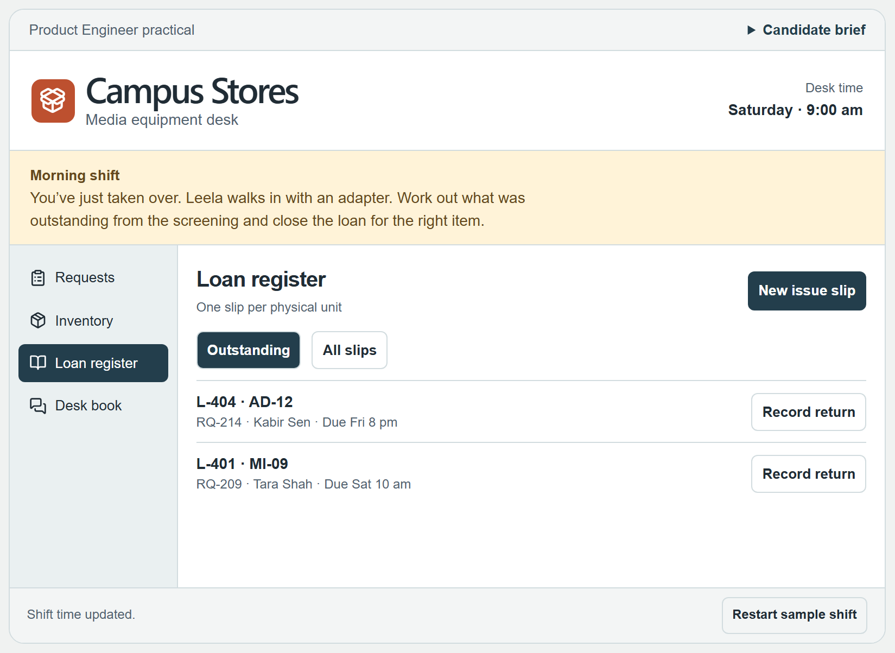
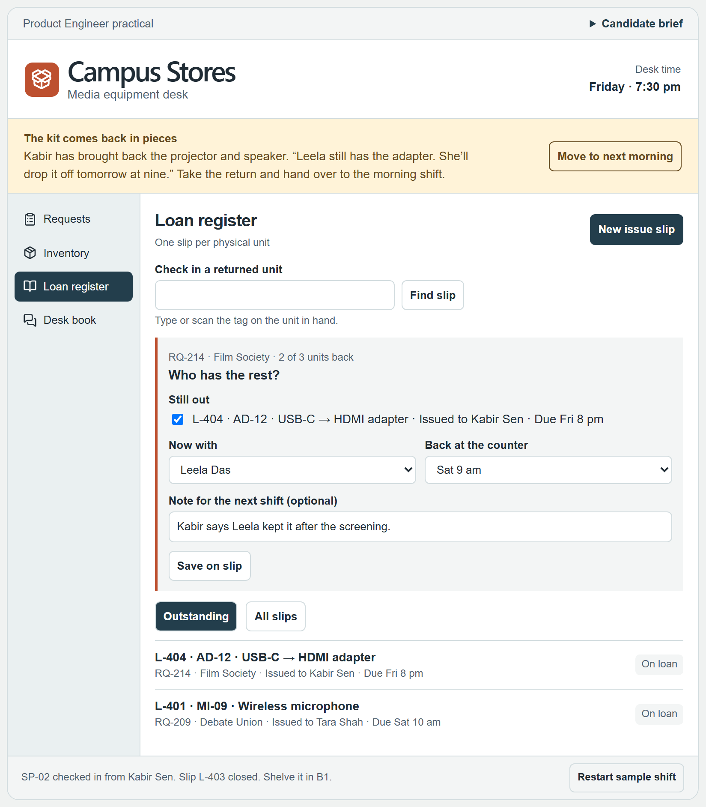
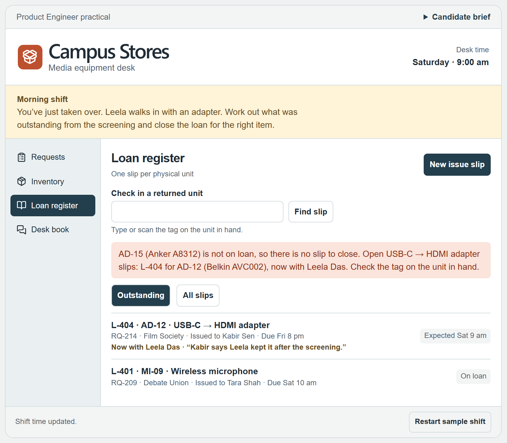

# Campus Stores

> **Reviewers:** my submission is the section below. To try it, open `index.html` (see [Run the app](#run-the-app)), click **Restart sample shift**, and work the Film Society shift. The changes are in `app.js` and `styles.css`, and the screenshots are in `docs/`.

## Candidate submission

**Would I keep this product? Yes.** Its core decision, one slip per physical unit, is right, and it carried the hardest moment of the shift. Where it breaks is the shift boundary, and that can be fixed without touching the core.

| The brief asks for | My answer |
| :-- | :-- |
| A moment it handles well | **Fri 7:30 pm, the partial return.** I closed the projector and speaker slips. The adapter's slip, L-404, stayed open on its own because every unit has its own slip. |
| A moment I'd change | **Sat 9:00 am, the handover.** Leela was at the counter, but L-404 still said "Kabir Sen · Due Fri 8 pm". **Record return** was one click with no undo. A double-click also closed Tara's microphone loan while she still had it. |
| My change | **Put the handover on the slip.** At 7:30 pm the register asks who has the rest and when they'll bring it back. At 9:00 am you close the slip by the tag on the unit in your hand. |
| One observation at a real counter | Can the morning clerk close a carried-over return without leaving the Loan register, and without asking anyone whose it is? |

### The shift I worked (original app)

- **Fri 3:45 pm, pickup.** I issued RQ-214 to Kabir Sen on three slips: L-402 PR-04 projector, L-403 SP-02 speaker and L-404 AD-12 adapter. PR-06, which is in the workshop, was never offered. When I tried CA-03 against RQ-214, the register refused it.
- **Fri 7:30 pm, partial return.** I recorded returns on L-402 and L-403. Kabir said Leela had the adapter and would bring it at nine. L-404 had nowhere to put that, so I wrote it in the Desk book.
- **Sat 9:00 am, morning shift.** The register showed `L-404 · AD-12 — RQ-214 · Kabir Sen · Due Fri 8 pm` above Tara's microphone. Each row had a **Record return** button.

### Keep: the partial return just worked

Closing L-402 and L-403 left L-404 open with no workaround. Inventory immediately showed PR-04 and SP-02 on the shelf and AD-12 still on loan, and in the morning exactly one Film Society item was outstanding. With one slip per request I'd have had two bad choices: close the whole kit and lose track of the adapter, or leave it all open and claim the projector was still out. Pickup was guarded the same way. With fifteen minutes before the film, the form only offered units that could actually leave, and it refused one the club hadn't been approved for.

### Change: nothing on L-404 connected Leela to it



- What I'd learned at 7:30 pm (*Leela has it, back at nine*) lived only in a free-text note on another tab.
- L-404 said `AD-12 · Kabir Sen · Due Fri 8 pm`. It didn't mention Leela, didn't say "adapter", and didn't say it was 13 hours late. To work out that her adapter was L-404, I read the Desk book and then looked AD-12 up in Inventory. AD-12 and AD-15 are two different adapters in the same bin, C4.
- **Record return** is one click. It doesn't check which unit is on the counter or record who brought it back, and it can't be undone. I double-clicked it: the first click closed L-404, the list reflowed, and the second click closed **L-401, Tara's microphone, which was still with Tara**. Inventory then showed MI-09 on the shelf.

### The prototype: one change, two moments

**At 7:30 pm, the slip captures the handover.** When a request has some units back and some still out, the register asks **Who has the rest?** The fields are *Now with*, *Back at the counter* and an optional note. Saving writes the answer onto those slips, and a matching entry goes in the Desk book, which stays the log. The prompt stays up until the answer is on the slips. If the evening shift skips it, the morning shift sees the open question, plus an **Overdue** tag.

**At 9:00 am, the slip closes against the unit in hand.** One field replaces the per-row return buttons: *Check in a returned unit — type or scan the tag on the unit in hand.* Entering `AD-12` (or `ad12`) opens that slip. The card shows the model, the shelf it goes back to, who it was issued to and the handover. *Returned by* is preselected to whoever the slip says is bringing it back. A tag with no open slip is stopped, and the message names the slip you probably meant. With no row buttons, a double-click can't close someone else's loan.

So that the slip reads on its own wherever you look, each row names the equipment, the club, the current holder and an *Expected* or *Overdue* tag. Outstanding is sorted by who is due at the counter next, and Inventory shows the slip and holder for anything on loan.

> **In the simulation** there's no adapter on the counter, so type the tag you'd read off it. At a real desk the label is on the unit. A USB barcode scanner types the tag and presses Enter, so check-in becomes one scan. That's the low-cost version of the tagging used in library circulation systems.

### Walkthrough: the same job with the change

- **3:45 pm.** Unchanged: three slips.
- **7:30 pm.** Check in `PR-04` and then `SP-02`. Each one is a single **Close slip**, returned by Kabir Sen. The register asks *RQ-214 · 2 of 3 units back — Who has the rest?* with L-404 ticked. Pick Leela Das and Sat 9 am, add a note, then **Save on slip**.

  

- **9:00 am.** The top row reads *L-404 · AD-12 · USB-C → HDMI adapter — Now with Leela Das — Expected Sat 9 am*. Leela hands over the adapter and I check in `AD-12`. The card shows the handover, *Shelve in C4* and *Returned by Leela Das*. **Close slip L-404.** Tara's loan isn't touched.

  

  If the adapter on the counter is actually AD-15, the check-in stops:

  

### Why this shape

Shift-handover studies from hospitals and airport ground handling keep coming back to a few conditions for unfinished work to survive a shift change. I used them as a checklist:

| A handover needs | Before | After |
| :-- | :-- | :-- |
| Unfinished work that's visible | A free-text note on another tab | "Who has the rest?" stays up until it's answered, and an Overdue tag shows if it never is |
| A named owner | The slip says Kabir | The slip says "Now with Leela Das" |
| A next action | None | Expected Sat 9 am, check in by tag, Shelve in C4 |
| Pickup by the next shift | Read the Desk book and piece it together | The Outstanding list opens on who is due at the counter next |

### What I kept

- One slip per physical unit, with Inventory worked out from the slips.
- The issue form and its guards. I didn't change pickup.
- The Desk book, for club messages and general notes.
- The existing code style, colour tokens, light and dark themes, and mobile layout. There are no new dependencies, and a shift saved by the original version still loads.

### What I left out on purpose

- **A fallback for a worn label**, such as finding the slip by number with a second confirmation. A real desk will need it, but this shift didn't.
- **Undo for a closed slip.** The tag check removes the one-click path. Undo comes next if mis-closes still happen.
- **Condition check on return** (working / needs repair). Equipment-loan systems check condition at issue and at return, and it belongs in this same check-in card. This shift had no damaged kit to test it against.
- **Faster pickup.** Issuing one request cost 12 dropdown choices, but pickup wasn't where this shift broke.
- **An "acknowledge handover" button.** A button nobody reads isn't a pickup. Opening the morning register on the expected returns does that job.

### One observation at a real counter

Watch the first carried-over return of a morning shift, when someone other than the borrower brings back part of a kit. **Does the clerk get from "here's the adapter" to a closed slip without leaving the Loan register, and without asking anyone whose it is?** If it helped, they check in the tag and close the slip. If it didn't, they still open the Desk book, ask the borrower which booking it was, or message the evening clerk.

### How I worked

I worked the whole shift by hand on the original first and logged each action. That log is the evidence above. My background reading on equipment-loan systems and shift handover gave me the checklist above. I built the change with help from an AI coding assistant (Claude Code) and tested it by walking the shift in the browser at desktop and phone widths, in light and dark themes.

---

Campus Stores is a Product Engineer work sample set at a fictional campus media equipment desk. Work through a club’s screening, from equipment pickup to a partial return and the next morning’s handover. Open **Candidate brief** in the app for the assignment.

## Run the app

Open `index.html` in a modern browser. The app includes its scripts, styles, and icons and can run offline.

To serve it over local HTTP, run this from the repository folder and visit `http://localhost:8000`.

```sh
python3 -m http.server 8000 --bind 127.0.0.1
```

Each browser stores its own sample shift locally when browser storage is available. **Restart sample shift** restores the fictional starting records.

## Source

- `index.html` contains the desk layout, candidate brief, and bundled icons.
- `app.js` contains the sample records and interactions.
- `styles.css` defines the desktop and mobile layouts.
- `docs/` holds the screenshots used in the candidate submission.

Icon license notices are in [third-party/lucide-LICENSE.txt](third-party/lucide-LICENSE.txt).


## Submit your work

1. [Fork Campus Stores](https://github.com/virinchi-healthcare/campus-stores/fork) into your GitHub account. Complete the candidate brief and push your changes to your public fork. In your README, point reviewers to your work and explain the decision you made.
2. In your fork, open **Commits**, select the final commit you want reviewed, and copy the page URL. It should look like `https://github.com/YOUR-USERNAME/campus-stores/commit/COMMIT-SHA`.
3. [Submit your work through the Google Form](https://docs.google.com/forms/d/e/1FAIpQLScvzoh1R4WS-SkiwAVBQbMvniieJYSoOEfLMyVo5CyjOvYUgQ/viewform). Your **roll number**, **email ID**, and **final commit link from your public fork** are required. Enter your roll number and email ID in the form only.
